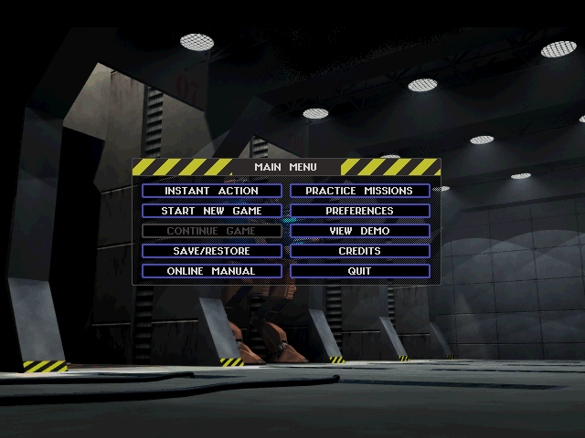
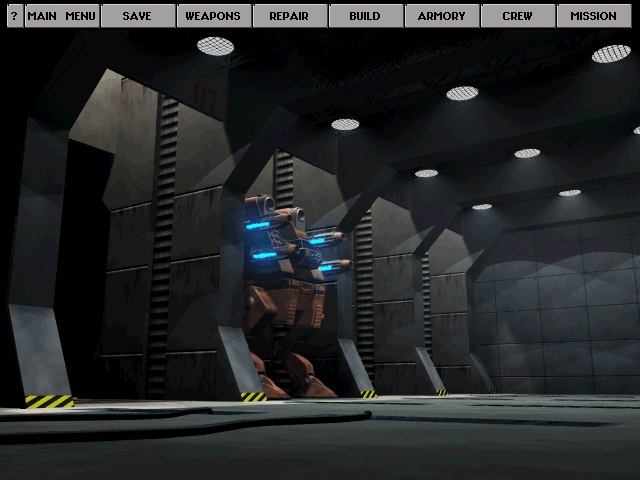
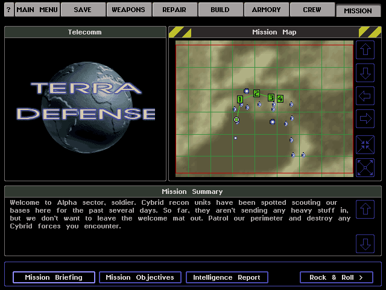
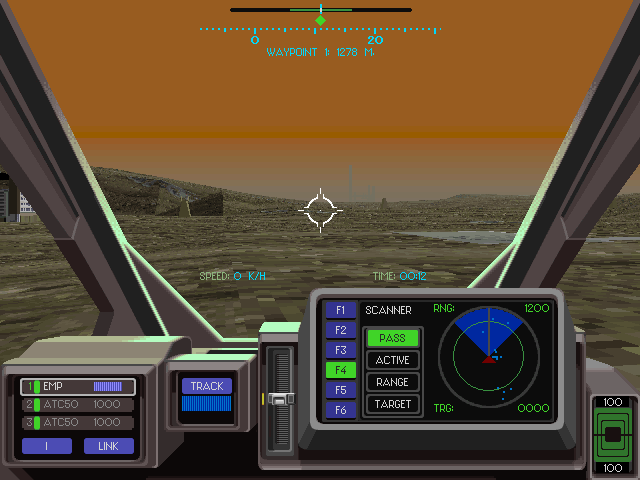

# Earth Siege 2: Static Recompilation


## What it is

A static recompilation of **Earth Siege 2** (Dynamix / Sierra, 1996, Windows 95)
from its shipping executables to native C. No emulator, no wrapper DLLs.

Built on the [pcrecomp](https://github.com/sp00nznet/pcrecomp) toolchain and
its native32 runtime, following its shared house style (layout, CLI, headless
mode). The game is two programs that its launcher `ES.EXE` ran in turn:
`VSHELL.EXE` (menus, hangar, briefings) and `DBSIM.EXE` (the sim). Each is
lifted whole into its own host, `es2shell.exe` and `es2sim.exe`, and
`es2shell --play` does what `ES.EXE` did.

**Nothing from the game is in this repository, and no generated source.** You
supply your own copy; the lifted C is generated on your machine into the
gitignored `src/recomp/gen/`.

## Status: v0.1.0-dev, early. In game: mission 1, the HERC walks and turns under keyboard control.

| Stage | State |
|---|---|
| Version recompiled | the 1996 CD release, v1.0 (`VSHELL.EXE` 10 Mar 1996, `DBSIM.EXE` 8 Mar 1996); no copy protection |
| Lift | 2 modules, Borland C++ 4.5/5.0: shell 4,142 entries, sim 6,204, 0 errors; pcrecomp `disasm32` + `drive32`, no IDA |
| Hosts (`build\es2shell.exe`, `build\es2sim.exe`, 32-bit, `native32`) | every import bound; the Borland runtime (`cw3220.dll`, `bwcc32.dll`) and the sound library (`sos9503.dll`) load natively |
| Shell | intro (skipped with `--skip-movies`), main menu, new pilot, hangar, mission 1 briefing, Rock & Roll |
| Sim | **mission 1 runs**: the 3D terrain renderer, cockpit, HUD, scanner, map; arrow keys turn and throttle the HERC |
| `--play` (ES.EXE's loop) | the shell hands over to the sim; with the shell's scripted clicks also replayed in the sim, the sim faulted once in its palette code (see ROADMAP) |
| Movies | Indeo 3 AVIs through MCI; `--skip-movies` ends each at once (no Indeo decoder on current Windows) |
| Sound | the game's own SOS library; `--headless` runs are muted |
| Headless (`--headless`, `--shot`, `--record`) | works: a private desktop, frames read from the game's 8-bit DIB |
| Toolkit | pcrecomp's `pcrecomp-ingame` branch, unchanged |
| Setup.cmd, launcher | written, not yet tested from a fresh clone |
| Conformance harness | none yet |

## Screenshots

Real output of `build\es2shell.exe --headless ... --shot`:

| | |
|---|---|
|  |  |
|  |  |

## Getting Started

You need **your own Earth Siege 2 CD**, copied to a writable folder (the
whole disc: `DBSIM.EXE`, `VSHELL.EXE`, `VOL\`, `AVI\`, `DATA\`, ...). Nothing
is installed; the game runs from that folder, and writes its saves and
mission state into its `DATA\` and `SAV\`.

### Quick start: Setup.cmd

1. Download this repository and unzip it somewhere with 1 GB free.
2. Double-click **`Setup.cmd`**.

It checks for Python 3.10+, `pefile` and `capstone`, the pcrecomp toolkit
(cloned on its `pcrecomp-ingame` branch if missing) and the Visual Studio 2022
C++ compiler, and **asks** before installing any of them. It asks where the
game is (`Setup.cmd -GameDir D:\es2` skips the question, `-Yes` answers yes),
links it as `game`, writes the two files the original installer did
(`DATA\drive.cfg`, `DATA\language.cfg`), catalogs and lifts both programs and
builds them. It ends with an **`Earth Siege 2`** shortcut
(`build\es2shell.exe --play --skip-movies`).

### Step by step

Prerequisites: Windows 10/11, Python 3.10+, git, Visual Studio 2022 (or its
Build Tools) with *Desktop development with C++*, and pcrecomp cloned
**beside** this repository on the `pcrecomp-ingame` branch.

```
git clone -b pcrecomp-ingame https://github.com/sp00nznet/pcrecomp
git clone https://github.com/sp00nznet/earthsiege2-recomp
cd earthsiege2-recomp
mklink /J game D:\es2                  (your copy of the CD)
echo D:\es2> game\DATA\drive.cfg & echo D:\es2>> game\DATA\drive.cfg
<nul set /p=E> game\DATA\language.cfg
py -3 -m pip install pefile capstone
py -3 tools\catalog.py                 (about 3 minutes)
py -3 run_lift.py
build.cmd
build\es2shell.exe --play --skip-movies
```

### Options

```
es2shell --play [host options]                the whole game (ES.EXE's loop)
es2shell|es2sim --run [host options] [game switches]   one program
  --headless            on a private desktop nothing reaches your screens (muted)
  --skip-movies         end every movie at once
  --shot S FILE.bmp     a screenshot S seconds in (repeatable)
  --record FILE.mp4     every presented frame (ffmpeg on PATH)
  --key VK@S[+HOLD]     press a key S seconds in, held HOLD seconds
  --click X,Y@S         click at a window point S seconds in
  --watchdog S          stop after S seconds and say where it was
```

The sim alone, on the mission the shell last set up:
`build\es2sim.exe dummy -eggplant -X2 -R0 --run`.

## How it works

See [docs/bringup.md](docs/bringup.md): what each module needed, in the
order it turned up.

## License

MIT for the code here ([LICENSE](LICENSE)). Earth Siege 2 is (c) 1996 Sierra
On-Line / Dynamix; no part of it is included.
