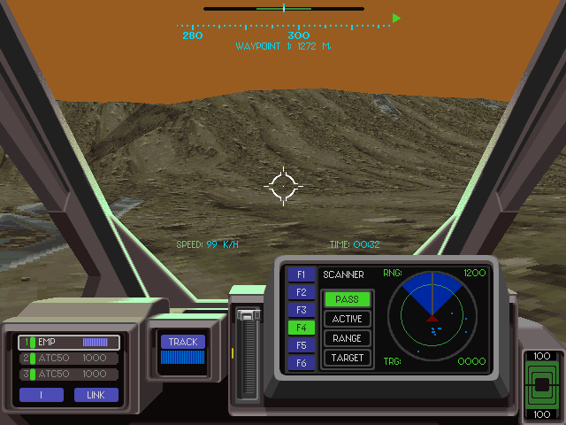

# Earth Siege 2 — Static Recompilation

Static recompilation of **Earth Siege 2** (Dynamix / Sierra, 1996, Windows
95) from its shipping executables to native C. The game is two programs that
its launcher `ES.EXE` ran in turn: `VSHELL.EXE` (menus, hangar, briefings)
and `DBSIM.EXE` (the sim). Each is lifted whole into its own 32-bit host,
`es2shell.exe` and `es2sim.exe`, and `es2shell --play` does what `ES.EXE`
did. No emulator, no wrapper DLLs.

Built on the [pcrecomp](https://github.com/sp00nznet/pcrecomp) toolchain, on
its **`pcrecomp-ingame`** branch (not yet merged into `main`), following its
shared house style.

## Getting Started

You need **your own Earth Siege 2 CD** (the 1996 v1.0 release), copied to a
writable folder: the whole disc, `DBSIM.EXE`, `VSHELL.EXE`, `VOL\`, `AVI\`,
`DATA\` and the rest. Nothing from the game is in this repository or
downloaded for you, and no generated source: the lifted C is made on your
machine into the gitignored `src/recomp/gen/`. Windows only for now.

### The setup scripts

1. Download this repository (the green **Code** button, then **Download ZIP**)
   and unzip it somewhere with 1 GB free.
2. Double-click **`Setup.cmd`**. Give it the folder with your copy of the CD
   when it asks (or `Setup.cmd -GameDir D:\es2`).
3. Play with the **`Earth Siege 2`** shortcut in that folder.

The script asks before installing anything (Python, `pefile` and `capstone`,
git, the Visual Studio 2022 Build Tools), clones pcrecomp's
`pcrecomp-ingame` branch beside this folder, links your copy as `game`,
writes the two files the original installer did, then catalogs, lifts and
builds both programs in about ten minutes; a rerun skips finished steps.
Building by hand and the command line are in
**[docs/building.md](docs/building.md)**. `setup.sh` only says there is no
Linux or macOS build yet.

## Status

**v0.1.0-dev, early.** In game in mission 1: the HERC walks and turns under
keyboard control.

| Stage | State |
|---|---|
| Version recompiled | the 1996 CD release, v1.0 (`VSHELL.EXE` 10 Mar 1996, `DBSIM.EXE` 8 Mar 1996); no copy protection |
| Lift | Borland C++ 4.5/5.0: shell 4,142 entries, sim 6,204, 0 errors; pcrecomp `disasm32` and `drive32`, no IDA |
| Hosts | every import bound; the Borland runtime (`cw3220.dll`, `bwcc32.dll`) and the sound library (`sos9503.dll`) load natively |
| Shell | intro, main menu, new pilot, hangar, mission 1 briefing, Rock & Roll |
| Sim | mission 1: the 3D terrain, cockpit, HUD, scanner and map; arrow keys turn and throttle |
| `--play` | the shell hands over to the sim; with scripted clicks replayed into the sim it faulted once in its palette code ([ROADMAP](ROADMAP.md)) |
| Movies | Indeo 3, which current Windows can't decode; `--skip-movies` ends each at once |
| Sound | the game's own SOS library; CD audio music is absent |
| Headless | `--headless`, `--shot`, `--record`: a private desktop, frames from the game's 8-bit DIB |
| Setup.cmd | tested from a fresh clone to the shortcut |
| Conformance harness | none yet |

[docs/bringup.md](docs/bringup.md) is the log of each wall and its fix, and
[ROADMAP.md](ROADMAP.md) what comes next.

## Screenshots

Recorded headlessly by the recompiled game (`--headless --shot`):

| | |
|---|---|
|  |  |
|  |  |

## Documentation

- [docs/building.md](docs/building.md): building by hand, the pcrecomp branch, the command line
- [docs/bringup.md](docs/bringup.md): every wall so far and its fix
- [ROADMAP.md](ROADMAP.md), [CHANGELOG.md](CHANGELOG.md), [CONTRIBUTING.md](CONTRIBUTING.md)

## Contributors

See **[CONTRIBUTORS.md](CONTRIBUTORS.md)** for who did what.

## License

MIT for this repository's own code ([LICENSE](LICENSE)). Earth Siege 2 is
© 1996 Sierra On-Line / Dynamix; none of its files, and nothing generated
from them, is in this repository ([NOTICE.md](NOTICE.md)).
